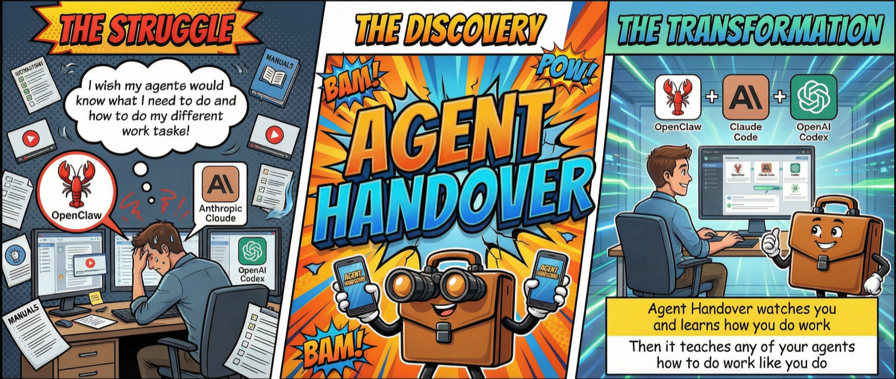

<p align="center">
  <sub>Created by Sandro Andric</sub>
  <br/>
  <a href="https://bysandro.com/"></a>
</p>

<p align="center">
  
</p>

<h1 align="center">AgentHandover</h1>

<p align="center">
  <strong>Work once. Hand over forever.</strong>
</p>

<p align="center">
  <a href="https://github.com/sandroandric/AgentHandover/releases/latest"></a>
  
  
  
  <a href="https://discord.gg/Fcx3X7CtBV"></a>
</p>

<p align="center">
  <a href="#demo">Demo</a> &middot;
  <a href="#quickstart">Quickstart</a> &middot;
  <a href="#what-you-can-automate">Use Cases</a> &middot;
  <a href="#what-a-skill-looks-like">What a Skill Looks Like</a> &middot;
  <a href="#how-it-works">How It Works</a> &middot;
  <a href="#memory">Memory</a> &middot;
  <a href="#commonplace">Commonplace</a> &middot;
  <a href="#v200">What's New</a> &middot;
  <a href="#connect-your-agent">Connect Your Agent</a> &middot;
  <a href="#install">Install</a> &middot;
  <a href="#privacy">Privacy</a> &middot;
  <a href="#contact">Contact</a>
</p>

---

<p align="center">
  
</p>

## Demo

<p align="center">
  <a href="https://youtu.be/29YzD88y-f4">
    
  </a>
</p>

<p align="center"><a href="https://youtu.be/29YzD88y-f4"><strong>New demo</strong></a> &middot; <a href="https://youtu.be/3nGH3rYbgfY">Original demo</a></p>

### Show it once. Hand it off forever.

AgentHandover watches how you work on your Mac, turns your workflows into reusable **Skills**, and lets agents like **Claude Code**, **OpenClaw**, **Hermes**, **Codex**, or any MCP-compatible tool execute them the way you do it.

Each Skill captures the *what*, the *why*, and the *how* — steps, strategy, decision logic, guardrails, and your writing voice — and says plainly what it doesn't know yet. And they **learn from use**: agents report back after every run, runs that follow the steps confirm them, and a run that deviates where a decision was only a guess turns into a question for you.

You already know how to do your work. Now your agents can too.

**New in 2.0: [Memory](#memory) and [Commonplace](#commonplace).** Everything AgentHandover sees on your screen also goes into a private memory on your Mac that you can search by describing it: *"the invoice from Acme"*, *"that orange news site"*. If you allow it, your agents can search it too.

## Why this matters

Getting an AI agent to do real work today means writing prompts or hand-crafting skills — brittle, time-consuming, and stale the moment your process changes. Worse, those skills capture *what* you do, not *how* you decide.

AgentHandover flips it. Instead of telling the agent how you work, you just work. The system watches, infers the strategy behind your clicks, and produces Skills with the *why* built in — selection criteria, guardrails, decision branches, your voice. Because agents report back after every run, Skills get better the more they're used.

Less time writing prompts. More time doing work that matters.

## What you can automate

AgentHandover learns whatever you do repeatedly on your Mac. A few examples of the kinds of workflows it handles well:

- **Research routines** — Your way of scanning sources, extracting key facts, and composing a summary.
- **Community engagement** — Daily check-ins on Reddit, Discord, or forums with your selection rules and voice.
- **Support triage** — How you read a ticket, check the dashboard, pick a macro, and draft a reply.
- **Data extraction** — Pulling structured data from a dashboard, CRM, or spreadsheet the way you do it.
- **Ops checklists** — Deploys, releases, status updates — your actual sequence with the decisions you make.
- **Personal skill library** — Any repetitive workflow you don't want to explain to an agent twice.

If it's a workflow you've done three times and will do again, it belongs in a Skill.

## Quickstart

1. **Install.** Download the latest `.pkg` from [Releases](https://github.com/sandroandric/AgentHandover/releases) and double-click. The onboarding app walks you through permissions, recommends models for your Mac's memory, and downloads them.
2. **Record a task.** Click **Record** in the menu bar, name it (e.g. *"Daily Reddit marketing"*), perform it once, click **Stop**.
3. **Answer up to 3 questions.** AgentHandover asks about what the recording couldn't show — *"What starts this task?"*, *"When is it done?"*, or a step it isn't sure of.
4. **Review and approve.** Open the Skill in the menu bar app, check the steps/strategy/guardrails, click **Approve for Agents**.
5. **Connect your agent.** `agenthandover connect claude-code` (or `codex` / `openclaw` / `hermes`). One command.
6. **Run it.** In Claude Code, type `/reddit-community-marketing` (or just describe the task). The agent executes your workflow.

That's the whole loop. Record once, hand off forever.

## What a Skill Looks Like

Here's an illustrative example of what a Skill looks like:

```
Reddit Community Marketing
Daily engagement workflow - 6 steps - 4 sessions learned

STRATEGY
Browse target subreddits for posts about marketing tools or growth
hacking. Engage with high-signal posts (10+ comments, posted within
48h, not promotional). Write authentic replies that acknowledge the
problem, share personal experience, and softly mention the product.

STEPS
1. Open Reddit and navigate to r/startups
2. Scan posts - skip promotional, skip < 10 comments
3. Open high-signal post and read top comments
4. Write reply: acknowledge -> experience -> mention product
5. Submit and verify not auto-removed
6. Repeat for r/marketing, r/growthacking (max 5/day)

SELECTION CRITERIA              GUARDRAILS
- Posts with 10+ comments       - Max 5 replies per day
- Not promotional or competitor - Never identical phrasing
- Posted within 48 hours        - Never reply to own posts
- Relevant to [product category]- Empathy-first tone always

VOICE & STYLE
Tone: casual | Sentences: short and punchy | Uses emoji
> Hey great point about the engagement metrics! We should
> def try that approach with the subreddit

~15 min daily - 9-10am                     Confidence: 89%
```

Skills follow the same format as Claude Code's native skills -- same frontmatter, same markdown structure -- but go further. Hand-written skills say "do X then Y." AgentHandover Skills include the strategy behind the steps, selection criteria, guardrails, your voice, and evidence from real observations: every step cites the frames it came from, and anything the recording didn't settle is listed as an open question instead of guessed.

## How It Works

### Two ways to teach

**Focus Recording** -- Click Record in the menu bar, name the task, perform it, click Stop. AgentHandover writes the Skill, checks every step against the recording, and asks up to 3 questions about what it still doesn't know (what starts the task, when it's done, a step it couldn't confirm). The Skill is waiting as a draft a few minutes after you stop. Best for workflows you want to hand off right now.

**Passive Discovery** -- Just work normally. AgentHandover groups your work into sessions, notices when the same task recurs, and drafts a Skill for the ones worth handing off (at most three new drafts a week). When you repeat a task you already have a Skill for, the session is recorded as another run of that Skill instead of a new one, and where you did it differently it becomes a branch. You don't have to do anything.

### You stay in control

Every Skill starts as a draft in your menu bar app. An agent sees it only when all four checks of the hand-off gate pass (`ledger.handoff_gate`, applied by the MCP server, every connector and every export):

| Check | What it requires |
|-------|------------------|
| **Approved** | You clicked Approve for Agents (lifecycle `agent_ready`) |
| **Known** | None of its required slots — goal, steps, done criteria — is unknown |
| **Trusted** | Its trust level is above `observe` (approval grants the first level) |
| **Fresh** | You did it recently: freshness halves every 30 days since it was last observed |

An approved Skill that fails a check is listed by `list_ready_skills` as held back, with the reason. Nothing auto-promotes; the system only suggests.

## Memory

New in 2.0. Find anything you saw on your Mac by describing it. Each screen AgentHandover keeps is embedded, the screenshot together with its app and window title, by Google's [EmbeddingGemma 2](https://huggingface.co/google/embeddinggemma-2) running in Ollama on your Mac. Near-identical screens of the same window in a row become one moment, so a long day stays a short list.

- **Search** from the menu bar (**Commonplace…**, the Memory scope), from the CLI (`agenthandover memory search "the Acme invoice"`), or let your agents search it (below).
- **What is kept.** For each moment: a short redacted description (the screen's annotation, or its screen text until one exists), the app and window title, the time and a search vector. The screenshot is deleted once it is embedded. A small thumbnail (about 480 px) is kept for 7 days to show in results, encrypted with a key in your Keychain that only the app and the capture daemon use. After that the description and vector remain, for a year by default.
- **Never kept.** What the privacy zones block: password managers, macOS password prompts, Keychain Access, banking, payroll and sign-in pages, and the apps, sites and hours you add to `[privacy.zones]`.
- **Forget and pause.** Forget the last hour, today, one moment, one app or everything, from the menu, the Commonplace window or `agenthandover memory forget`. Forget deletes the screens, descriptions, vectors, thumbnails, search entries and that day's summaries; your approved Skills stay. Pause Memory for an hour, until tomorrow or until you resume; Skills still learn from what you do.
- **Agents.** One switch, off by default: **Let agents search my Memory** (Memory Settings, or `agenthandover memory agents on`). Agents then find Memory through [Commonplace](#commonplace) (`search_commonplace`, or `search_memory`, over MCP; `agenthandover search` in a terminal): descriptions, apps, window titles and times, never images or file paths.
- **Light.** Embedding is a low-priority background job, about half a second a screen. It waits while macOS reports memory pressure or less than 2 GB is free, while a two-model tier is writing Skills, and after 600 screens in an hour; its model is unloaded a minute after the last screen.
- **Needs** Ollama 0.40 or later (EmbeddingGemma 2 runs on Ollama's MLX runner) and `embeddinggemma-2:440m` (710 MB), which setup or the upgrade offer downloads.

**How well it finds things.** On the 16 GB test Mac (Ollama 0.40.3), 26 screens (20 public web pages in look-alike pairs and 6 app screens) and 52 questions, half about what a screen said and half about how it looked, run through Memory's own writer and search: the right screen came first for 90% of the questions and was in the top five for all of them; for questions about the look, 88% first. Embedding the same screens' title and screen text with `nomic-embed-text`, the model 0.5 searches with, found 75% first, and 65% of the questions about the look. One small set, so indicative. On real Safari windows captured by AgentHandover on the same Mac (16 pages, each opened from another app, so the window came up still showing the previous page), searched through the Memory window's search afterwards: all 16 questions about what a page said found it first; 14 of 16 about how it looked found it first and 15 of 16 were in the top three.

**Memory only.** If you want Memory without Skills, choose **Memory only** in setup or in Memory Settings (or run `agenthandover skills learn off`). AgentHandover then keeps capturing and filling Memory, and runs no model but Memory's: no screen descriptions, Skill drafts, questions or daily summaries, so nothing larger than the 710 MB embedding model is downloaded or loaded. Commonplace, pause, forget, privacy zones and agents' Memory search work as usual; your existing Skills stay available to your agents. Descriptions are the screen's own text, since nothing writes annotations. Switch back with **Skills + Memory** (`agenthandover skills learn on`); the menu then offers to download the Skill models.

**Upgrading from 0.5**, the app asks once: **Add Memory** (Skill search keeps `nomic-embed-text`), **Upgrade everything** (Skill search, task grouping and session linking move to EmbeddingGemma 2 too: your Skills are re-indexed in the background and switched over in one step when it is done, and search keeps working meanwhile), or **Not now**. New installs use EmbeddingGemma 2 for everything.

## Commonplace

New in 2.0. Everything AgentHandover knows about your work, in one place your agents can search: **Skills** (the workflows it learned from you, and whether each may be handed off), **Memory** (what was on your screen, only when you let agents search it), **daily summaries** (what you worked on each day) and your **profile** (tools, working hours, writing style). All of it stays on your Mac.

- **In the app.** **Commonplace…** in the menu bar opens one search over your Memory, days and Skills, grouped by kind (what you saw first), with scope chips (All, Memory, Days, Skills). Return opens a result: a moment in place, a Skill in Workflows, a day in the Daily Digest. Your own search always includes Memory; a line at the top says what agents can see and turns their Memory access on or off.
- **Agents know it exists.** The MCP server's instructions describe Commonplace to every connected agent, and `agenthandover connect` adds a short Commonplace note where each agent reads its instructions (Claude Code's `/agenthandover-list`, Codex's `AGENTS.md` block, an `agenthandover-commonplace` Skill for Hermes, `memory/apprentice/commonplace.md` in the OpenClaw workspace; `connect mcp` prints it for any other agent).
- **One search, grouped by kind.** `search_commonplace(query, kinds?, since?, until?, limit?)` over MCP, `agenthandover search "…"` in a terminal (`--kinds skills,memory,days,profile`, `--since`, `--until`, `-n`, `--json`), or `POST /commonplace/search` on the REST API. Each kind is ranked by its own scorer and returned in its own group, so a Skill's score is never weighed against a Memory moment's. When an embedding model is busy or down, that kind falls back to matching the query's words and says so.
- **What agents get.** Text: Skill titles, descriptions and hand-off status; Memory descriptions, apps, window titles and times; a day's date, apps and an excerpt of its tasks; the profile. Never vectors, images, thumbnails or file paths. Memory answers only while **Let agents search my Memory** is on; otherwise its group says how you can turn it on. The switch applies to the next search, no restart.
- **Things to try.** In the app (the empty Commonplace window offers these too): *"the invoice from Acme"*, *"that page with the orange header"* (by how it looked), *"the error in the terminal"*, *"how I deploy to staging"* (a Skill), *"the day I spent in Figma"* (a day). Ask your agent:
  - *"Write my weekly update from what I actually did this week."*
  - *"Find the pricing article I read yesterday and summarise it."* (needs Memory access)
  - *"Pick up where I left off on the onboarding doc."* (needs Memory access)
  - *"Before you ask me how I release, check my Skills."*
  - *"Roast my week: where did my hours really go?"*
- **What it is not.** A permission boundary against software that already runs as you. The switch governs what AgentHandover hands to agents (MCP, `agenthandover search`, the REST search); an agent that can run any command as you (Claude Code with shell access, for example) can do what you can, including `agenthandover memory search`, and the data lives in files under your home folder that any process with your file access can read, as with any app's data. AgentHandover tells connected agents never to change its settings or read its files; it cannot enforce that against a process running as you.

## The Knowledge Base

Everything AgentHandover learns lives in a local knowledge base on your machine. It's not a flat list of files -- it's an active intelligence layer that gets smarter the more you work.

**Knowledge ledger** -- Every Skill tracks what it knows: each slot (goal, steps, done criteria, trigger, decisions, verification, inputs, exceptions, guardrails, voice, context) is *known*, a *hypothesis*, or *unknown*, with pointers to the frames, answers or agent runs behind it. Questions come from the gaps (unknown or guessed slots, and steps the recording didn't settle), within a budget of 5 a week (`weekly_question_budget`), and no model writes them.

**Vector store** -- Every observation is embedded (nomic-embed-text, 768d) so the system finds similar workflows by meaning, deduplicates Skills that describe the same task differently, and links activity across sessions.

**Voice profiles** -- Your writing style accumulates per workflow and strengthens over sessions. One reply is a guess. Twenty replies is a fingerprint the agent can match. Casual on Reddit, formal in client emails -- the system knows the difference.

**User profile** -- Aggregated across all workflows: your tools, working hours, communication patterns, and overall writing style. Agents read this to adapt to you.

**Semantic search** -- Agents can search the knowledge base by meaning via the MCP server or REST API. "Find something about deploying" returns your staging deployment Skill even if it's titled "Push to Prod." When the embedding model is busy or down, search falls back to matching the query's words in titles, descriptions, tags and steps.

## Execution Feedback Loop

Most tools stop at "here's a procedure, good luck." AgentHandover closes the loop. When an agent executes a Skill, it reports back what happened -- and the Skill learns from it.

**How it works**: Every Skill includes an execution protocol. The agent calls `report_execution_start` before beginning, `report_step_result` after each step, and `report_execution_complete` when done. Every run is kept, and:

- **Completed** -- counts toward the Skill's execution confidence (kept apart from how well the Skill is grounded in what you did) and confirms it is still current. After 3 runs that follow the steps as written, the steps count as known.
- **Deviated** -- what the agent did instead is kept as an observed alternative for that step. A deviation where a decision was only a hypothesis makes that decision unknown again and asks you about it.
- **Failed** -- recorded with the error as a drift signal on the Skill.

Agent runs never rewrite your steps on their own: the Skill changes through your answers and your review.

### One-click agent pairing

The menu bar app detects installed agents (Claude Code, Cursor, Windsurf, Codex, OpenClaw) and connects them with one click: Claude Code through `claude mcp add --scope user`, Codex through `codex mcp add`, the others by adding the server to their MCP config file. The menu shows **Connected** only when the agent reports the server (for Claude Code `claude mcp list`, for Codex `codex mcp list --json`).

## Connect Your Agent

| Agent | Command | What it gets |
|-------|---------|--------------|
| Claude Code | `agenthandover connect claude-code` | Skills in `~/.claude/skills/`, plus the MCP server |
| Codex | `agenthandover connect codex` | A marked block in `./AGENTS.md` |
| OpenClaw | `agenthandover connect openclaw` | Skills synced to the OpenClaw workspace |
| Hermes | `agenthandover connect hermes` | Skills in `~/.hermes/skills/agenthandover/` |
| Anything MCP | `agenthandover connect mcp` | The MCP server config to paste |

Every connector hands over only the Skills that pass the hand-off gate, and tells the agent about [Commonplace](#commonplace).

### MCP Server (recommended)

One config line, any agent. Works with Claude Code, Cursor, Windsurf, and any MCP-compatible tool.

```json
{
  "mcpServers": {
    "agenthandover": {
      "command": "agenthandover-mcp"
    }
  }
}
```

It exposes these tools and resources (generated from the server):

<!-- mcp-tools:start -->
| Tool | What it does |
|------|-------------|
| `search_commonplace(query)` | Search Commonplace: everything AgentHandover knows about the user's work. |
| `list_ready_skills()` | List the Skills an agent may run, and the approved ones held back. |
| `list_all_skills()` | List ALL Skills with their lifecycle state. |
| `get_skill(slug)` | Get a full Skill by slug. |
| `search_skills(query)` | Semantic search — find Skills by meaning, not just keywords. |
| `search_memory(query)` | Search the user's Memory: what was on their screen, by meaning. |
| `get_user_profile()` | Get the user's profile — tools, working hours, writing style. |
| `report_execution_start(slug)` | Report that you are starting to execute a Skill. |
| `report_step_result(execution_id, step_id)` | Report the result of a single step during Skill execution. |
| `report_execution_complete(execution_id)` | Report that Skill execution is finished. |

| Resource | What it is |
|----------|-----------|
| `agenthandover://procedures` | Index of all learned procedures with status. |
| `agenthandover://profile` | User profile as readable text. |
| `agenthandover://procedures/{slug}` | Full Skill as readable markdown. |
<!-- mcp-tools:end -->

### Claude Code

```bash
agenthandover connect claude-code
```

Installs every Skill that passes the hand-off gate as a Claude Code Skill (`~/.claude/skills/<slug>/SKILL.md`) and registers the MCP server with `claude mcp add --scope user --transport stdio agenthandover -- /usr/local/bin/agenthandover-mcp`. Type `/reddit-community-marketing`, or describe the task and Claude Code picks the Skill. `/agenthandover-list` lists them.

### Codex

```bash
agenthandover connect codex
```

Writes all agent-ready Skills, strategy, guardrails, and voice guidance into `./AGENTS.md` (or `--path`), between `<!-- BEGIN agenthandover -->` and `<!-- END agenthandover -->` markers; a rerun replaces only that block. An existing `AGENTS.md` without the markers is left alone unless you pass `--append` (add the block at the end) or `--force` (replace the file).

### OpenClaw

```bash
agenthandover connect openclaw
```

With `[export] adapter` set to `openclaw` or `all` (a pkg install writes `all`), the worker writes approved Skills into the OpenClaw workspace (`~/.openclaw/workspace/memory/apprentice/`); the command checks the workspace and reports what is synced.

### Hermes

```bash
agenthandover connect hermes
```

Installs your Skills into `~/.hermes/skills/agenthandover/<slug>/SKILL.md` for [Hermes](https://github.com/NousResearch/hermes-agent), Nous Research's self-improving agent. Hermes walks `~/.hermes/skills/` looking for `SKILL.md` files (agentskills.io / anthropic-skills convention), so AgentHandover Skills drop in directly — `/skills` lists them, `/<skill-name>` runs them. For live semantic search and the execution-feedback loop, also add the MCP server to `~/.hermes/config.yaml`:

```yaml
mcp:
  servers:
    agenthandover:
      command: "agenthandover-mcp"
```

### REST API

Already running on localhost:9477 (loopback only). Every POST needs the
`X-AgentHandover-Token` header; the worker keeps the token in a file only
your user can read. Requests that carry a browser `Origin` header, or a
`Host` other than `127.0.0.1:9477` / `localhost:9477`, are refused, so a
web page cannot reach the API.

```bash
curl http://localhost:9477/ready              # Agent-ready Skills
curl http://localhost:9477/bundle/my-workflow  # Handoff bundle (read only)
TOKEN=$(cat ~/Library/Application\ Support/agenthandover/query-api-token)
curl -X POST http://localhost:9477/bundle/my-workflow \
  -H "X-AgentHandover-Token: $TOKEN"          # Compile it for every adapter
curl -X POST http://localhost:9477/search/semantic \
  -H "X-AgentHandover-Token: $TOKEN" \
  -d '{"query": "deploy to production"}'      # Semantic search
curl -X POST http://localhost:9477/commonplace/search \
  -H "X-AgentHandover-Token: $TOKEN" \
  -d '{"query": "the Acme invoice", "kinds": ["memory", "days"]}'  # Commonplace
```

## Install

### Download and run

Download the latest `.pkg` from [**Releases**](https://github.com/sandroandric/AgentHandover/releases) and double-click. Requires macOS 14 (Sonoma) or later and [Ollama](https://ollama.com/download); [Memory](#memory) needs Ollama 0.40 or later.

The onboarding app walks you through: permissions, AI model downloads (it recommends a tier for your Mac's RAM and shows the memory each tier needs against what is free now), Chrome extension, and your first recording.

Upgrading keeps your observing state: if you were observing before, capture resumes as soon as macOS permissions are in place, and setup opens only at a permission that is missing. A model configuration that the app or installer wrote for an earlier default (including every 0.4.x setup) moves to your tier's current models, but only once they are downloaded: until then your Mac keeps the models it has. After upgrading from 0.4.x the app asks once, "0.5 uses a faster model (…). Download now?"; the download is 1.9 GB (`qwen3.5:2b-q4_K_M`) if you ran 0.4's Standard models and 3.4 GB (`qwen3.5:4b`) otherwise, and the switch (after a timestamped backup) happens when it finishes. "Not now" keeps your current models until the next upgrade; `agenthandover doctor` names the switch and `agenthandover setup --tier <tier>` makes it. A `[vlm]` block you edited yourself is left alone.

<details>
<summary><strong>Developer / advanced install</strong></summary>

### CLI setup

```bash
agenthandover doctor     # Verify prerequisites
agenthandover start all  # Start daemon + worker
```

`agenthandover doctor` checks permissions (through the app), services, the worker's environment, the browser extension, and your machine: which Ollama serves the port (and warns when Ollama is installed twice), its version against the minimum, and memory, swap and disk headroom for your tier.

### AI Models

AgentHandover picks a tier from your Mac's RAM during onboarding; you can choose another tier, or name your own models, in onboarding or in `config.toml` (`[vlm] annotation_model` / `sop_model`). The table lives in one place (`TIERS` in `worker/src/agenthandover_worker/model_profiles.py`, installed as `tiers.json`); onboarding, `agenthandover setup --vlm [--tier ID]`, `agenthandover doctor` and the worker all read it. Every tier also pulls an embedding model for search: `embeddinggemma-2:440m` (EmbeddingGemma 2, 710 MB, which also powers [Memory](#memory)) with Ollama 0.40 or later, `nomic-embed-text` with an older Ollama (Memory then waits for the update).

<!-- tiers:start -->
| RAM | Tier | Screen annotation | Skill writing | Download |
|-----|------|-------------------|---------------|----------|
| 8 GB | Standard | `qwen3.5:2b-q4_K_M` | `qwen3.5:4b` | ~5.6 GB |
| 16 GB+ | Recommended | `qwen3.5:4b` | `qwen3.5:4b` | ~3.7 GB |
| 24 GB+ | Performance | `qwen3.5:4b` | `gemma4:12b-it-qat` | ~10.9 GB |
| 48 GB+ | Max Quality | `qwen3.5:4b` | `gemma4:31b-it-qat` | ~21.7 GB |
<!-- tiers:end -->

Why these models (measured on a 16 GB test Mac with Ollama 0.34.2, replaying a recorded focus session's prompts; one sample each, so indicative):

- **A small model annotates every screen.** Text-first annotation reads the screen's OCR and page elements and looks at the image only when the text isn't enough; qwen3.5:4b annotated 11 frames in 24 s (~2.2 s a frame). gemma4:12b-it-qat took 40+ s per frame with the image.
- **Qwen 3.5 4B writes Skills up to 16 GB.** Head to head, it wrote the Skill in 153 s at 29.5 tok/s with 18 steps, against Gemma 4 12B's 230 s at 12.1 tok/s with 10 steps, and asked the better question. With ordinary apps open, Gemma 12B did not fit next to it: one live session took 50 minutes from Stop to questions with the two models (the Q&A waited 30 min for a model that never loaded) and ~2.5 minutes with Qwen alone.
- **8 GB Macs annotate with Qwen 3.5 2B** (`qwen3.5:2b-q4_K_M`, 1.9 GB): about 55 tok/s, 10/10 valid annotations with the right app 10/10, resident all day in ~2.3 GB instead of the 4B's ~3.8 GB. It is not good enough to write Skills (10 steps against the 4B's 18), so the 4B writes them, loaded one model at a time. This tier was measured on the 16 GB Mac, not on an 8 GB one.
- **From 24 GB a Gemma 4 QAT model writes Skills**, where quality matters and calls are rare.

`agenthandover bench --tier ID --cassette FILE` measures a tier's models on a recorded session's prompts (tok/s and agreement with the recorded answers), so you can check another model before you switch.

The Gemma 4 tiers (24 GB and up) need **Ollama 0.34.0+**; the Qwen tiers work on older Ollama. `agenthandover doctor` fails an older Ollama only when a configured model is Gemma 4, and warns otherwise. All models run fully local.

Where a tier's two models differ, the worker runs one at a time: annotation first, then Skills. Before loading the Skills model it checks free memory, macOS's memory pressure, swap (an emergency stop at twice the Mac's memory) and disk; when the model won't fit it defers the work instead of pushing the Mac into swap, and stops waiting on a model that doesn't load within a minute.

```bash
# Or pull manually (Recommended tier):
ollama pull qwen3.5:4b          # Screen annotation and Skills (~3.4 GB)
ollama pull embeddinggemma-2:440m  # Search and Memory, Ollama 0.40+ (~710 MB)
ollama pull nomic-embed-text    # Search with an older Ollama (~274 MB)
# Standard tier (8 GB) adds:
ollama pull qwen3.5:2b-q4_K_M   # Screen annotation (~1.9 GB)
# Performance tier (24 GB) adds:
ollama pull gemma4:12b-it-qat   # Skill generation (~7.2 GB)
```

### Chrome extension

```bash
agenthandover setup --extension
```

Installs the native-messaging host manifest, copies the extension's folder path to the clipboard and opens `chrome://extensions`: enable Developer Mode, click Load unpacked, and paste the path. `agenthandover doctor` shows the same folder.

### Homebrew (cask)

```bash
brew tap sandroandric/agenthandover
brew install --cask agenthandover
```

The cask downloads the signed, notarized `.pkg` from GitHub releases and runs Apple's installer — you get bit-identical behavior to the direct-download path, so all TCC (Accessibility + Screen Recording), launchd, and Ollama onboarding flows work the same. Uninstall cleanly with `brew uninstall --cask agenthandover` (use `--zap` to also remove `~/Library/Application Support/agenthandover`).

### Source build (Rust, Node.js 18+, Python 3.11+, Swift / Xcode CLT, [just](https://github.com/casey/just))

```bash
git clone https://github.com/sandroandric/AgentHandover.git && cd AgentHandover
just package-pkg              # builds daemon + CLI + extension + app, then runs
                              # scripts/build-pkg.sh to package target/AgentHandover-<version>.pkg
sudo installer -pkg target/AgentHandover-*.pkg -target /
```

`scripts/build-pkg.sh` only packages: it takes the daemon and CLI prebuilt from `target/universal-release/` (`just build-daemon build-cli`), builds the app, builds the extension when `extension/dist` is missing, and copies the worker source. It signs the binaries and the package only when a Developer ID Application / Installer identity is in your keychain; otherwise the package is unsigned. The `justfile` has individual `just build-daemon`, `just build-cli`, etc. recipes if you need to rebuild a single component during development. The version lives in each component's manifest; `python3 scripts/version.py check` verifies they agree and `set X.Y.Z` stamps them all.

</details>

### Choose your AI model

AgentHandover runs its models locally through Ollama: free and private. Screen annotation, Skill writing, synthesis, questions and embeddings all use Ollama, on your Mac or on another machine you point `[vlm] ollama_host` at. There is no cloud mode (it was removed in 0.5.0).

Pick the tier's models via `config.toml` or `agenthandover setup --vlm`.

## The Menu Bar App

AgentHandover lives in your menu bar:

- **Status** -- daemon and worker health
- **Today's stats** -- events captured, annotations completed, Skills generated
- **Attention items** -- questions waiting, drafts ready for review
- **Record** -- one click to start a focus recording
- **Workflows** -- browse all Skills, approve drafts, see what each Skill knows and what it doesn't
- **Memory** -- search what you saw, pause Memory, forget the last hour or today, and Memory Settings
- **Digest** -- daily summary of what was learned, and the questions still open

Review the strategy, steps, and guardrails. Click "Approve for Agents" when it looks right. One click. No Skill reaches agents without your sign-off.

## Privacy

Everything runs on your machine:

- **Local-only models.** Every model runs through Ollama on your Mac (or the Ollama host you configure). No cloud model API is called and no API key is stored.
- **Screenshots are temporary.** Each frame is a JPEG of the focused window at half its native pixel resolution (one pixel per point on a Retina display), deleted after annotation and, with Memory on, after it is embedded (Memory gives up on a frame it could not embed within 48 hours). Frames never annotated are deleted by the daily maintenance run once they are older than `job_ttl_days` (default 7). Only structured text, Memory's vectors and its encrypted thumbnails survive.
- **Memory stays on your Mac.** Its descriptions, vectors and thumbnails are stored with the rest of your data, and the thumbnails are AES-256-GCM encrypted with a key kept in your Keychain. A Memory vector encodes what was on screen, so treat it like the screenshot it came from: it never leaves the Mac, agents get descriptions only when you allow it, and forget deletes it.
- **Redaction where the data flows.** API keys, tokens, passwords (including "password is …" phrasings) and card numbers are scrubbed by the daemon before anything is stored, and again by the worker before any text goes into a model prompt. URLs keep their origin and path; query strings are dropped except for a short allow-list of harmless keys.
- **Blocked by default.** Password managers, macOS password and Touch ID prompts, permission dialogs, the login window, Apple's Passwords app, and banking, payroll and login pages are never captured, and neither are AgentHandover's own windows (Commonplace shows other moments, so capturing it would copy them). Add your own apps, URLs and quiet hours as privacy zones (`[privacy.zones]`): the daemon checks them before it takes a frame and again after, and the worker once more on stored events.
- **Secure field exclusion.** Password and credit card inputs are never captured, and form values are left out of browser snapshots unless you turn on `capture_input_values`.
- **No keylogging.** Each frame records only how many keys were pressed since the previous frame (macOS's key-press counter): no key codes, no text, no event tap, no Input Monitoring permission. Typed text in a Skill must be backed by it. Keys from text expanders, remote control and automation count; text inserted by Apple Dictation or other voice typing presses no key, so dictated text is not recorded as typed input yet.
- **Clipboard.** A copy is recorded as an event; the copied text itself is kept only if you turn on `enable_clipboard_preview`.
- **Reading app state is opt-in.** Reading the open document, page or message from Safari, Mail, Notes and a few other apps needs macOS's per-app Automation consent, so it is off until you turn it on in onboarding.
- **Knowledge base is local.** Vector store, voice profiles, and all Skills live on your machine. Never uploaded.
- **No encryption at rest of its own**, except Memory's thumbnails. Screenshots, the event database and the knowledge base are stored as plain files under your home folder; turn on FileVault to encrypt them on disk.
- **Configurable retention.** Raw events are deleted after 14 days (`retention_days_raw`); the Skills keep the evidence they cite.
- **No telemetry.** AgentHandover sends no usage data and none of your content anywhere. The only request the app makes on its own is Sparkle's daily update check against `www.agenthandover.com/appcast.xml`; turn it off with `defaults write com.agenthandover.app SUEnableAutomaticChecks -bool false`.

<details>
<summary><strong>The pipeline (technical)</strong></summary>

This is not a screen recorder with ChatGPT on top. AgentHandover runs a pipeline that turns raw screen activity into agent-ready Skills:

| Stage | What it does |
|-------|-------------|
| **1. Event-driven capture** | A frame of the focused window when something happens: an app or title switch, a navigation, a form submit, a click that changed the screen, a copy, or a slow heartbeat. Privacy zones are checked before the shutter, and a frame whose screen didn't change is dropped before OCR runs |
| **2. Text-first annotation** | A small local model reads each frame's OCR text and page elements -- what app, what URL, what you're doing -- and looks at the image only when the text isn't enough. An annotation cache answers screens it has already seen for free |
| **3. Compute caps** | Passive annotation stays within 60 frames and 10 model-minutes per hour and 1,500 frames and 60 minutes per day; focus recordings are exempt |
| **4. Activity classification** | 8-class taxonomy separates work from noise. Your expense filing is "work." Your YouTube break is "entertainment." |
| **5. Embeddings** | Every annotation embedded into a vector knowledge base (nomic-embed-text, 768d) |
| **6. Sessions and recurrence** | Groups activity into work sessions, links the same task across days, and measures how often and how regularly it recurs |
| **7. Recognition** | A session or recording that matches an existing Skill becomes a run of it; where it differs, a branch |
| **8. Skill generation** | Writes the Skill with semantic dedup (won't create duplicates even if you describe the same workflow differently) |
| **9. Grounding** | Checks every step against the recording: frame citations, UI targets, order, the lines you typed, a copy or paste only where the clipboard shows one, a scroll or save only where the screen shows it. What it cannot confirm becomes a question |
| **10. Behavioral synthesis** | Extracts strategy, selection criteria, guardrails, decision branches and timing -- grounded in the user's profile (tools, role, accounts) |
| **11. Knowledge ledger** | Tracks what each Skill knows, as a hypothesis or not at all, with evidence; asks budgeted questions about the gaps |
| **12. Human review** | You approve before any agent can execute, and the hand-off gate re-checks every time. Nothing auto-promotes. |

Model work runs on one inference thread in priority order (a stopped recording first, passive work last), so the app and your answers are never stuck behind a long model call; when the backlog grows, the daemon captures less often.

Every stage runs locally on your Mac. No cloud APIs.

</details>

<details>
<summary><strong>Architecture</strong></summary>

```
                              You work normally
                                    |
                                    v
Chrome Extension -----> Daemon (Rust) ---SQLite WAL---> Worker (Python)
  DOM snapshots           Screenshots                     |
  Click targets           OS events                       v
  Form field IDs          Clipboard                  Pipeline:
                          Change detection           Text-first annotation
                          Privacy zones              Activity classification
                    Menu Bar App (SwiftUI)            Embeddings
                    Status - Record - Workflows      Sessions + recurrence
                    Digest - Questions               Skill generation
                                                     Grounding
                                                     Behavioral synthesis
                                                     Knowledge ledger
                                                          |
                                                          v
                                              +------------------------+
                                              |    Knowledge Base      |
                                              |                        |
                                              |  Skills (v3 schema)    |
                                              |  Knowledge ledger      |
                                              |  Vector store (768d)   |
                                              |  Voice profiles        |
                                              |  User profile          |
                                              |  Evidence + runs       |
                                              +-----+------+-----------+
                                                    |      |
                                      +-------------+      +------------+
                                      v              v                  v
                                MCP Server     Claude Code       OpenClaw
                                (any agent)    Skills            Hermes
                                Codex          REST API
                                AGENTS.md      localhost:9477
```

| Component | Language | Role |
|-----------|----------|------|
| **Daemon** | Rust | Always-on observer -- screenshots, OS events, clipboard, change detection, privacy zones, redaction; owns the database schema |
| **Worker** | Python | Intelligence -- the pipeline, vector KB, knowledge ledger, behavioral synthesis, voice analysis, lifecycle, export |
| **Extension** | TypeScript | Chrome MV3 -- DOM snapshots, click targets, form field context, ARIA labels |
| **CLI** | Rust | Service management, doctor, focus recording, agent connection |
| **App** | SwiftUI | Menu bar -- status, recording, workflows, digest, questions |
| **MCP Server** | Python | Universal agent interface -- 8 tools + 3 resources via MCP protocol |
| **Knowledge Base** | SQLite + JSON | Skills, vector store, voice profiles, user profile, evidence, runs |

</details>

<details>
<summary><strong>CLI reference</strong></summary>

Generated from the CLI's own definition (`agenthandover <command> --help` has the details):

<!-- cli-table:start -->
| Command | What it does | Options |
|---------|--------------|---------|
| `agenthandover status` | Show daemon and worker status | `--compute` |
| `agenthandover start [SERVICE]` | Start services (daemon launched directly, worker via launchd) |  |
| `agenthandover stop [SERVICE]` | Stop services (daemon via SIGTERM, worker via launchd) |  |
| `agenthandover restart [SERVICE]` | Restart services |  |
| `agenthandover logs [SERVICE]` | View service logs | `--follow` `--lines` |
| `agenthandover config show` | Show current configuration |  |
| `agenthandover config edit` | Open config file in $EDITOR |  |
| `agenthandover config path` | Print the config file path |  |
| `agenthandover skills list` | List all generated SOPs (exported + drafts) |  |
| `agenthandover skills show <SLUG>` | Show a specific SOP by slug (works for exported and draft SOPs) |  |
| `agenthandover skills dir` | Print the SOPs directory path |  |
| `agenthandover skills drafts` | List draft SOPs awaiting review |  |
| `agenthandover skills approve <SLUG_OR_ID>` | Approve a draft SOP (agents see it only once promoted to agent_ready) |  |
| `agenthandover skills reject <SLUG_OR_ID>` | Reject a draft SOP |  |
| `agenthandover skills promote <SLUG> <TO_STATE>` | Promote a procedure's lifecycle state (e.g., draft → reviewed → verified → agent_ready) |  |
| `agenthandover skills failed` | List failed SOP generations |  |
| `agenthandover skills retry <FAILURE_ID>` | Retry a failed SOP generation |  |
| `agenthandover skills learn <STATE>` | Learn Skills from how you work (on), or Memory only (off: no model but Memory's) |  |
| `agenthandover watch` | Live-updating status dashboard (refreshes every 2s) |  |
| `agenthandover setup` | Interactive setup wizard | `--check` `--extension` `--vlm` `--tier` `--shell` `--shell-remove` |
| `agenthandover doctor` | Run pre-flight checks | `--ollama-json` `--mode` `--extension-json` |
| `agenthandover uninstall` | Uninstall AgentHandover | `--purge-data` |
| `agenthandover focus start <TITLE>` | Start recording a workflow demonstration |  |
| `agenthandover focus stop` | Stop the active focus recording session |  |
| `agenthandover focus finalize` | Answer the focus recording's pending questions in the terminal |  |
| `agenthandover focus skip-questions` | Skip the pending questions (the Skill keeps them as not yet known) |  |
| `agenthandover export` | Export SOPs in a specific format | `--format` `--sop` `--output` |
| `agenthandover search <QUERY>` | Search Commonplace: your Skills, Memory (when agents may search it), daily summaries and profile | `--kinds` `--since` `--until` `--limit` `--json` |
| `agenthandover connect <AGENT> [OPTIONS]...` | Connect an AI agent (claude-code, codex, openclaw, hermes, mcp) |  |
| `agenthandover bench [OPTIONS]...` | Model bake-off: replay a journey cassette's prompts against a tier's live models and report tok/s and a golden-diff score | `--tier` |
| `agenthandover memory search <QUERY>` | Search Memory by meaning ("the Acme invoice", "the error in the terminal") | `--since` `--until` `--app` `--limit` `--json` |
| `agenthandover memory forget` | Forget a stretch of time, an app, a moment or everything (asks first) | `--last` `--today` `--since` `--until` `--app` `--moment` `--all` `--yes` |
| `agenthandover memory pause` | Pause Memory (Skills still learn; pause observing in the app for that) | `--for` |
| `agenthandover memory resume` | Resume Memory |  |
| `agenthandover memory status` | What Memory holds, and whether it is on or paused | `--json` |
| `agenthandover memory agents <STATE>` | Let agents search Memory (MCP and `agenthandover search`: descriptions, never images), or stop them |  |
| `agenthandover recall` | Recall what you were doing at a given time | `--date` `--app` `--start` `--end` |
<!-- cli-table:end -->

</details>

## Uninstall

```bash
agenthandover uninstall              # Remove services, keep data
agenthandover uninstall --purge-data # Remove everything
```

## Contributing

AgentHandover is early and unusually high-leverage for contributors. The prompt files, agent connectors, and skill templates are all plain text that anyone can read, run, and improve — a careful hour of prompt tuning can measurably change the quality of every Skill the tool produces for every user.

### Ways to help (no code required)

- **Share a Skill you actually use.** Record a real workflow, review the generated Skill, and post it in [Discussions → Show & Tell](https://github.com/sandroandric/AgentHandover/discussions). Real workflows beat synthetic examples and become the reference library everyone learns from.
- **Report bad outputs.** Did a generated Skill miss a step, add a redundant click, or misread your strategy? Open an [issue](https://github.com/sandroandric/AgentHandover/issues) with the Skill + what it should have been. The prompts get tuned directly from this feedback.
- **Bug reports from real usage.** Everything is logged locally so reproductions are usually easy. The more unusual your Mac setup, model tier, or workflow, the more valuable the report.
- **Answer questions in [Discussions](https://github.com/sandroandric/AgentHandover/discussions).** Anyone who's used the tool for more than a week has context new users need.

### Code contributions we'd love

- **New agent connectors.** Follow the pattern in [`worker/src/agenthandover_worker/agent_connect.py`](worker/src/agenthandover_worker/agent_connect.py). Cline, Aider, RooCode, and any agent that reads Claude Code-format skills or MCP are straightforward — the Hermes and Codex connectors are short, and every connector hands over only what passes `ledger.handoff_gate`.
- **Model runtimes.** Every model call goes to Ollama through one client ([`worker/src/agenthandover_worker/ollama.py`](worker/src/agenthandover_worker/ollama.py)). A second local runtime for annotation and Skills (with structured output) would be a real addition.
- **Prompt engineering.** The prompts in [`sop_generator.py`](worker/src/agenthandover_worker/sop_generator.py) and [`behavioral_synthesizer.py`](worker/src/agenthandover_worker/behavioral_synthesizer.py) drive the entire output quality. If you see a way to make them more precise, more robust, or better at handling your language, send a PR; `agenthandover bench` and the recorded journey cassettes let you measure the change.
- **Browser extension ports.** Chrome / Chromium / Brave / Edge / Arc / Comet are supported. Firefox and Safari are wide open.
- **Privacy review.** This is a local-first tool that handles sensitive data. Extra eyes on [`crates/common/src/redaction.rs`](crates/common/src/redaction.rs), the worker's prompt-side [`redaction.py`](worker/src/agenthandover_worker/redaction.py), the privacy zones and the screenshot retention path ([`crates/storage/src/maintenance.rs`](crates/storage/src/maintenance.rs)) are genuinely wanted.

### Getting started

If you're not sure where to begin, open a [Discussion](https://github.com/sandroandric/AgentHandover/discussions) with a rough idea — it's faster to shape something together than to send a PR cold. Small PRs get reviewed quickly. If your contribution is non-trivial, running `just test` and `cargo test` before opening the PR saves a review round-trip. `tests/integration/test_docs.py` and the CLI's `docs_tests` keep this README's tables and commands in step with the code.

Direct line for anything that doesn't fit: [sandro@sandric.co](mailto:sandro@sandric.co).

## Community

[**Join the AgentHandover Discord →**](https://discord.gg/Fcx3X7CtBV)

The Discord is where the community actually talks in real time:

- **#skills-gallery** — share a Skill you're using and see what other people have built
- **#help** — get a response in minutes instead of days
- **#bugs** — fast triage before things become GitHub issues
- **#dev** — prompt engineering, connector authors, contributor chat
- **#announcements** — release notes and updates

GitHub [Discussions](https://github.com/sandroandric/AgentHandover/discussions) and [Issues](https://github.com/sandroandric/AgentHandover/issues) are still the right home for anything that should be public and searchable long-term — bug reports with reproductions, feature proposals, design discussions. Discord is for the ephemeral stuff in between.

## Contact

[sandro@sandric.co](mailto:sandro@sandric.co)

## Changelog

### v2.0.1

Fixes found on the first upgrade of a 24 GB MacBook Pro.

- **The Skills model's swap limit follows the Mac.** 2.0.0 held back the model that writes Skills whenever more than 8 GB of swap was in use, on every Mac; swap stays in use long after the pressure that caused it, so a 24 GB Mac at 8.5 GB of swap would not write Skills. The worker now waits while macOS reports memory pressure (warning or critical), as Memory already did, and keeps swap only as an emergency stop at twice the Mac's memory (32 GB on a 16 GB Mac, which still catches the ~44 GB that once crashed our test Mac). `agenthandover doctor` warns at the same points.
- **Setup speaks of the mode you picked.** With Memory only selected, setup's Ollama panel still warned about the Skill models (their Ollama minimum and the swap limit), because it read the settings file, which names the mode only after the download. It now reports for the mode on screen: in Memory only, an Ollama older than 0.40 is the one problem, said plainly. Setup no longer says "Local setup looks good." when there is nothing it can download, and the button says "Pull Model" for Memory's one model.

### v2.0.0

The biggest release yet. AgentHandover grows from Skills into a private memory of everything you saw, and **Commonplace**, one place you and your agents search for everything it knows: what you saw, your days and your Skills. The version jumps from 0.5 to 2.0 to say so. Numbers are measurements on the 16 GB test Mac with Ollama 0.40.3 unless stated.

- **Memory.** Search anything you saw by describing it, from the menu bar, the CLI or (if you allow it) your agents. Each kept screen is embedded with its app and window title by EmbeddingGemma 2 on your Mac; near-identical screens of one window become one moment. On 52 questions about 26 screens: the right screen first 90% of the time, in the top five every time, 88% first for questions about how a screen looked (0.5's text search: 75% and 65%). See [Memory](#memory).
- **Commonplace.** Your Skills, Memory, daily summaries and profile as one hub your agents know about and can search (`search_commonplace` over MCP, `agenthandover search` in a terminal), grouped by kind, text only, Memory only when you allow it. See [Commonplace](#commonplace).
- **The Commonplace window.** **Commonplace…** in the menu bar: one search over what you saw, your days and your Skills, with thumbnails, a moment opening in place, a Skill in Workflows and a day in the Daily Digest, and a line saying what your agents can see. Empty, it suggests searches and requests to give your agents (*"Roast my week: where did my hours really go?"*).
- **Light enough to leave on.** Memory embeds each screen in about half a second as a background job that waits while macOS reports memory pressure; its search index is held as 8-bit numbers, loaded on the first search and freed after 10 idle minutes (300,000 moments: 207 MB while in use instead of 666 MB, with identical results).
- **Memory only.** Want Memory without Skills? Choose Memory only in setup or Memory Settings: AgentHandover then runs one 710 MB model and nothing else, no Skill writing in the background. See [Memory](#memory).
- **Private by construction.** Thumbnails are AES-256-GCM encrypted with a Keychain key and kept 7 days; descriptions are redacted; privacy zones are never kept; forget deletes a time range, an app, a moment or everything, including the day's summaries; nothing captured while Memory is paused is ever kept, nor are AgentHandover's own windows; agents' access is a separate switch, off by default, and returns text, never images.
- **EmbeddingGemma 2 for search.** New installs use it for Skill search, task grouping and session linking too; upgraders choose Add Memory or Upgrade everything (a background re-index that switches over in one step). Every threshold was measured on labelled sets for both models: with EmbeddingGemma, session linking separates same-task from different-task pairs completely (nomic: two thirds), and Skill search ranked 15 of 16 agent questions first (nomic: 16 of 16).
- **Frames show the right page.** A frame used to be taken the moment a window's title changed, before the app had drawn the new page, so it could show the page you were leaving. Capture now waits until the window has been still for a second (at most three), one frame per change.
- **Fixes in search.** Search compared vectors of different models when they had the same size, and the daily vector purge would have deleted the vectors of any model but the configured one; `/search/semantic` answers malformed requests with 400 instead of crashing.
- **Removed.** The SigLIP "Visual search" option: it stored image vectors that nothing ever searched. If you had it on, the upgrade offer says Memory replaces it.
- **Needs Ollama 0.40 or later** for Memory and EmbeddingGemma 2; with an older Ollama everything else works as in 0.5 and `agenthandover doctor` says what to update.

### v0.5.0

The biggest release since the first one, and the one where the product does what this README says. Skills are built from what was actually recorded, a recording turns into a Skill and its questions in minutes instead of most of an hour, everything runs on your Mac, and it stays light enough to leave on all day. Numbers are single measurements on a 16 GB test Mac (Ollama 0.34.2) unless stated.

- **Right-sized models.** The 16 GB tier runs Qwen 3.5 4B for everything, and 8 GB Macs annotate with Qwen 3.5 2B (see [AI Models](#ai-models) for the head-to-head). On the same kind of focus session, Stop to questions went from 50 minutes with Gemma 4 12B (v0.4.0's 16 GB default) to ~2.5 minutes (later sessions took 3.5 and 5); the Skill was written in 60 s instead of 549 s.
- **Memory-aware scheduling.** Where a tier has two models the worker loads one at a time, checks memory, swap and disk first, and defers instead of pushing the Mac into swap. Model work runs on one inference thread in priority order, so the app stays responsive during long calls.
- **Event-driven capture.** Frames when something happens, of the focused window at one pixel per point (a 1324×940 pt Safari window is captured at 1324×940 px). Unchanged screens skip OCR and the model.
- **Text-first annotation.** A small model reads OCR and page elements (~2.2 s a frame) and looks at the image only when needed; a cache answers screens already seen. On a recorded busy hour: 1,190 cache hits and 10 model calls instead of 896 and 304, and 422 model-seconds within the 600 s hourly budget.
- **Privacy where the data flows.** Redaction before storage and before every prompt, URL query strings dropped, macOS password, Touch ID and permission prompts blocked, privacy zones checked before and after the shutter, clipboard text off by default, reading app state opt-in.
- **Grounded Skill steps.** Every step is checked against the recording: a copy or paste needs clipboard evidence, a scroll or save needs screen evidence, typed lines are quoted exactly and need key presses behind them (text the model read off a toolbar no longer becomes a "type" step), clicks carry DOM anchors, steps keep the recorded order and cite their frames. Passively discovered Skills get element anchors too.
- **Knowledge ledger and budgeted questions.** Each Skill tracks what it knows, guesses and doesn't know, with evidence. The four-check hand-off gate replaces the six gates. Questions come from the gaps (up to 3 after a recording, 5 a week) and no model writes them.
- **Recognition of repeated workflows.** Passive mining measures recurrence and drafts at most 3 new Skills a week; doing a task you already have a Skill for becomes a run of it (a branch where you did it differently), not a duplicate. Drafts keep learning from later runs until you approve them, and a run interrupted by a call stays one run.
- **Agent runs feed Skills.** Three runs that follow the steps confirm them; a deviation on a guessed decision reopens it as a question.
- **Doctor checks the machine.** The serving Ollama's version and install, duplicate installs, and memory, swap and disk headroom; an old Ollama fails only when a Gemma 4 model is configured.
- **Upgrades keep observation on.** Setup reopens only at a missing permission, stale grants from a changed signature are reset, and model configs written for an earlier default move to the tier's current models once the app has downloaded them.
- **Agents.** `search_skills` answered in 17.5 s instead of 255 s while Ollama was busy (an 8 s embedding timeout and a keyword fallback). Claude Code pairs through `claude mcp add` with a real Connected check; Codex gets a marked `AGENTS.md` block.
- **Light enough to leave on.** Idle with capture on, the menu bar app uses about 0.3 s of CPU a minute and the capture daemon 0.09 s; models unload when there is nothing to do, and model time is capped per hour and per day. The daily pass that compared every pair of tasks with its own model requests (35,983 requests on the three-week journey) now makes 422.
- **The daily pass works again.** Since v0.4.0 it stopped on every day with work, so the daily digest, profile, patterns and the day's questions never ran from it.
- **Capture starts reliably.** With a Chromium browser open, the app took the extension's helper for the capture daemon and never started it, after upgrades and at login. A second recording no longer erases the first one's unanswered questions, and upgrades remove the files a release dropped.
- **Cluster labels and synthesis run every day.** The LLM reasoner and the behavioral synthesizer used to share their daily budget with the VLM fallback queue, so after 50 unclassified events a day every later cluster label and synthesis was skipped without a word. They now have their own budget (`[vlm] reasoning_max_calls_per_day`, `reasoning_max_compute_minutes_per_day`), and when it is spent `worker-status.json` and `agenthandover status --compute` say so.
- **Removed.** Cloud mode: it never did the main work (screen annotation and Skill writing always ran on Ollama), and by 0.5.0 it only sent the older focus path's Skill steps to a provider for a description, while reading its API key from an environment variable the app never set. The upgrade turns an old cloud config local (with a backup) and deletes the stored API key. Also the MLX and llama.cpp backends (they only ever served the fallback queue), the fallback queue itself (its answers fed nothing but its own re-scoring), the legacy pattern miner, the six gates, and config keys that nothing read.
- **Corrections to v0.4.0's notes.** Homebrew's `ollama` 0.34.2 runs the QAT tags on the test Mac, and the Gemma tiers need Ollama 0.34.0+, not 0.30.6.

### v0.4.0 (2026-06-09)

New default local models — Google's **QAT (Quantization-Aware Training) Gemma 4** checkpoints — chosen by a head-to-head A/B test on a real focus recording, not by spec sheets.

**The 16 GB tier moves from Gemma 4 E4B to Gemma 4 **12B QAT** (and uses *less* memory: ~7 GB vs ~9.6 GB).** In the A/B, the E4B model couldn't even identify what the recorded workflow was — it returned *"Unclear … the user does not complete a final artifact"* on both runs. The 12B QAT model correctly identified the task both runs (*"Drafts a daily news digest email, subject 'Thursday Daily News', aggregating updates from X, Reddit, and Hacker News"*), extracted a typed variable, and produced goal-directed steps. A 12B-dense model fits where a 4B-effective one used to, and reasons dramatically better about *why* you did what you did — which is where Skill quality lives.

New tier table:

| RAM | Was | Now | Download |
|-----|-----|-----|----------|
| 8 GB | Qwen 3.5 | Qwen 3.5 (unchanged) | ~6 GB |
| 16 GB | Gemma 4 E4B | **Gemma 4 12B QAT** | ~7 GB (was ~10) |
| 24 GB | Gemma 4 E4B Q8 | **Gemma 4 12B QAT** | ~7 GB (was ~12) |
| 48 GB+ | Gemma 4 31B | **Gemma 4 31B QAT** | ~18 GB (was ~20) |

The 8 GB tier **stays on Qwen 3.5** — we A/B-tested the smallest Gemma QAT (e2b) there too, and it was a *regression*: the 2B model got the task wrong both runs while Qwen 3.5:4b nailed it. Small models lose the plot; we didn't ship that to the most constrained users.

**Ollama 0.30.6+ now required for the Gemma tiers.** The QAT tags need it (older Ollama returns HTTP 412 on pull). Install the [official Ollama app](https://ollama.com/download) or `brew install --cask ollama-app` — note the Homebrew `ollama` *formula* does not bundle the GGUF runner and cannot run these models, so onboarding now points to the official app. The 8 GB Qwen tier still works on older Ollama.

3026/3026 Python tests pass. Existing installs keep their current model until re-onboarded; new installs and `agenthandover setup --vlm` get the new defaults.

### v0.3.0 (2026-05-06)

The biggest Skill-quality jump since v0.2.0. Fixes a chain of silent data losses between the VLM, the saved procedure JSON, and the app UI — every one of which left users looking at procedures that were a fraction of what the model had actually produced.

**Step descriptions are now saved AND rendered.** Gemma 4 e4b emits a `description` field on every step (verified 19/19 on the dailynews validation run). Two separate bugs were dropping it: (1) `procedure_schema.sop_template_to_procedure()` constructed `proc_step` without copying `step["description"]`, so the saved JSON only had `action`. (2) Even with description in the JSON, `SOPDetailView.swift` rendered it as a `??`-fallback for `action` — meaning whenever action was populated (always), description was silently swallowed by the fallback chain. The Swift step card now shows action (bold) + description (dim) + `→ target` (monospaced) + `Input:` + `✓ verify` lines, all conditional. Old v0.2.x procedures with no description look the same as before.

**Behavioral synthesis fails loud.** When the VLM returned an empty insights JSON (no goal, strategy, selection criteria, or guardrails), the worker silently set `last_synthesized` and moved on — leaving the procedure with empty behavioral fields and never retrying. Now raises `EmptyInsightsError` on substantively-empty extractions, retries once, and only stamps `last_synthesized` when the extraction had substantive content.

**Voice profile picks up real user-authored text.** Style analyzer was reading from `extracted_evidence.content_produced`, which is populated late in the pipeline and was empty for most fresh sessions — so first-time users got a generic voice. Now reads from clipboard events, step inputs/descriptions, and content samples too, with URL/JSON/short-string rejection filters. Min combined text lowered from 50 → 30 chars.

**Q&A no longer corrupts procedures.** Free-text answers from the focus questioner were being auto-merged into `accounts`, `branches`, and `decision` structured fields by `_merge_credentials()` and `_merge_decision()` — overwriting clean structured data with prose fragments. Both helpers removed. `FocusQuestion` now carries a `step_indexes` field; clarifications do targeted in-place rewrites of the specific steps the question covered. `_merge_strategy()` is kept but only fires when no synthesised strategy exists yet.

**Variables wired into step text.** Declared variables with concrete examples are now post-substituted into step `step`/`description`/`target` and `parameters.input`/`verify`/`location` as `{{varname}}` templates by a new `_wire_variables_into_steps()` pass. Skips generic example values (`yes`/`no`/`true`/`false`) and sorts longest-first to avoid partial matches inside longer strings.

**Brace double-wrap fix.** Gemma occasionally wraps an already-templated reference in another `{{...}}`, producing `{{{{var}}suffix}}` — caught in the wild as `target: '{{{{bohemia}}.io}}'`. New `_unwrap_double_templated()` regex pass collapses these to `{{var}}suffix` on every step's text fields.

**Schemas tightened.** `FOCUS_SOP_PROMPT`, `PASSIVE_SOP_PROMPT`, and `ENRICHED_PASSIVE_PROMPT` now require `description` and `verify` per step. The coherence-check rule was refined so intermediate actions aren't dropped as "unused later" — that rule was over-eagerly removing legitimate workflow steps.

**Tests:** 3026/3026 Python tests pass. Validated end-to-end on the dailynews focus session: 19/19 steps with rich descriptions, 19/19 verifies, 0 brace bugs, 0 Q&A corruption, behavioral synthesis confidence 0.81 with retries=0.

### v0.2.10 (2026-04-18)

Fixes the daemon silently disappearing after the launching shell exits. When you ran `agenthandover restart` from a terminal and then closed that terminal (or the shell exited for any reason), the daemon would die within seconds — no crash, no logs, nothing. Root cause: the daemon's parent-process ID correctly reparented to 1 (init/launchd), but its **process group ID** stayed tied to the launching shell. When the shell closed its controlling TTY, SIGHUP was sent to every process in that group — including the daemon. Default SIGHUP action is immediate termination with no signal handler invocation, no stderr output, no unified log entry.

**Fix (`crates/daemon/src/main.rs`):** the daemon now calls `libc::setsid()` at the very top of `main()`, making itself its own session leader. Detached from the launching shell's session and process group, so SIGHUP no longer reaches it when the shell exits. Also added a SIGHUP signal handler (defense in depth) that treats the signal as clean shutdown if it ever arrives via another path.

Verified live: with the fix, daemon spawned from a subshell that exits immediately continues running with its own process group (`PGID == PID`) and is marked as a session leader in `ps`. Before the fix, the daemon's PGID matched the spawning shell's PGID and it died on shell exit.

### v0.2.9 (2026-04-16)

Removes three more instances of the same `tokio::time::timeout` + `spawn_blocking` pattern that caused the v0.2.8 OCR crash. v0.2.8 fixed one instance (Vision/OCR); three identical patterns remained in clipboard monitoring (`macos_clipboard.rs` — two timeouts), accessibility checks (`macos_accessibility.rs`), and AppleScript queries (`applescript_bridge.rs`). All have the same bug: Tokio drops the future on timeout but the blocking thread keeps running ObjC/system calls; when those calls complete, cleanup runs outside the `@try/@catch` scope and an uncaught ObjC exception aborts the process. The clipboard one is especially suspect because it fires immediately on daemon startup — matching the "daemon dies within seconds" timing reported on v0.2.8. All four blocking calls now run to completion without outer timeouts.

### v0.2.8 (2026-04-15)

Fixes a daemon abort caused by a Tokio-level OCR timeout that left an in-flight Vision framework call orphaned in the thread pool. When the timeout fired, Tokio dropped the future but the blocking thread kept running the ObjC Vision call; when Vision eventually finished, cleanup ran outside the `@try/@catch/@autoreleasepool` scope in `perform_ocr_safe()`, and the uncaught ObjC exception triggered `abort()` — killing the daemon with no signal handler invocation, no shutdown logs, no cleanup. Reported by hikoae with a precise diagnostic snapshot showing `OCR timed out after 500ms` as the last log line before silent process death.

Three changes:
- **Dropped the Tokio-level OCR timeout.** The blocking Vision call now runs to completion inside `spawn_blocking`. Vision returns in tens of milliseconds in the overwhelming majority of cases; outlier calls taking a second or two are vastly preferable to crashing the daemon. This is the actual fix.
- **Installed a panic hook** at daemon startup that logs panics via `tracing::error!` before the process dies. Rust's default panic printer writes to stderr, which was being redirected to `/dev/null` — so any panic in a Tokio task was invisible.
- **Redirected daemon stderr to `daemon.stderr.log`** in both the Swift menu bar app's `Process()` spawn and the Rust CLI's `Command::spawn` path (previously `/dev/null`). Future ObjC `NSException` messages and panic backtraces will now leave a diagnostic trail.

### v0.2.7 (2026-04-14)

Fixes confusing status reporting after toggling "Observe Me" off. The main daemon correctly stopped on pause, but `daemon-status.json` was never deleted — so the CLI kept reading the stale file, seeing a dead PID, and reporting "not responding". Meanwhile Chrome would keep spawning stateless `ah-observer` native-messaging bridge instances whenever the extension tried to communicate, which would write fresh `extension-heartbeat.json` entries and show the extension as "connected" while the daemon showed red.

Three changes:
- **Daemon clears its own status file on clean shutdown** — matches the worker's `_remove_worker_status()` behavior. The SIGTERM-driven cleanup path now removes `daemon-status.json` right after `daemon.pid`, at the source.
- **`ServiceController.stopAll()` removes the native messaging host manifest** on pause, so Chrome can't spawn transient bridge instances. Extension cleanly goes to "disconnected" on pause instead of staying green via bridge processes. `startAll()` re-installs the manifest on resume (symmetric).
- **`agenthandover stop daemon` also removes the status file** — belt-and-suspenders cleanup for the case where the daemon didn't exit cleanly.

After v0.2.7, `agenthandover status` shows a clean "not running" state when observation is paused, and the extension indicator matches daemon state.

### v0.2.6 (2026-04-12)

Fixes worker startup state detection and native host manifest reliability.

**`is_job_running()` now checks for an actual running process, not just a registered job**
- The CLI's `is_job_running()` used `launchctl list <label>` which returns success when the job is *registered* in launchd, even if the process isn't running (PID is `-`). This caused `agenthandover start` to falsely report "Worker already running" when the worker wasn't actually running. Rewrote to use `launchctl print gui/<uid>/<label>` and parse for `pid = <N>` where N > 0 — the same check the Swift menu bar app uses. `agenthandover start` and `agenthandover status` now agree on whether the worker is actually running.

**Native host manifest written directly by postinstall**
- v0.2.5 removed stale manifests in postinstall and relied on the app to recreate them on launch. If the app didn't launch cleanly, manifests stayed deleted. v0.2.6 writes the correct manifest directly in the postinstall (belt and suspenders — the app still overwrites on launch). No more `agenthandover setup --extension` needed after install.

**Worker writes an early "starting" status file before heavy initialization**
- Previously `worker-status.json` was written only after ~700 lines of initialization (DB connect, module imports, knowledge base, vector KB, Ollama checks). If anything failed before that point, no status file existed and the CLI reported "not running" even though the Python process was alive. v0.2.6 writes a minimal status file with `"vlm_mode": "starting"` immediately after PID file creation, then updates it to the full status once initialization completes.

### v0.2.5 (2026-04-12)

Fixes the Chrome extension native messaging connection. The `allowed_origins` in the native host manifest was using a stale extension ID (`knldjmfmopnpolahpmmgbagdohdnhkik`) that didn't match the actual ID derived from the `key` field in `manifest.json` (`jpemkdcihaijkolbkankcldmiimmmnfo`). Chrome correctly rejected the connection with "Access to the specified native messaging host is forbidden." Fixed in 9 locations across the codebase. The app re-writes the native host manifest on every launch, so upgrading to v0.2.5 and restarting the app is sufficient — no manual editing required.

### v0.2.4 (2026-04-11)

Hotfix for three follow-up issues reported on the v0.2.3 install. All three were install-time / lifecycle issues — the observation and SOP pipelines are unchanged.

**Installer — correct user detection on edge cases**
- `postinstall` now cascades through four methods to find the real logged-in user instead of relying on `stat -f '%Su' /dev/console` alone. On at least one reporter's machine, `/dev/console` was owned by `root` at install time, which cascaded into `dscl . -read /Users/root NFSHomeDirectory` → `/var/root`, which is a real directory on macOS, so the `[ -d "$USER_HOME" ]` safety check passed and the LaunchAgent got copied to `/var/root/Library/LaunchAgents/` instead of the user's home. Silent failure — `launchctl` from the user's session never saw the plist. New order: `scutil show State:/Users/ConsoleUser` (Apple's canonical GUI-user source) → `SUDO_USER` env var → `stat -f '%Su' /dev/console` → first-real-user scan via `dscl . list /Users UniqueID` filtered to UID ≥ 500. Each method is validated via `_valid_user()` (UID must exist AND be ≥ 500), the `postinstall` hard-fails with an explicit error message if none of the four methods find a real user, and it refuses to install if `USER_HOME` ever resolves to `/var/root` or empty. The install diagnostic now prints `Installing for user: <user> (UID=<uid>, HOME=<home>, detected via <method>)` so future bug reports include the detection path.

**CLI — `agenthandover start worker` no longer prints a spurious error**
- `start_worker_launchd()` used to call `launchctl load -w <plist>` (deprecated) via a wrapper that auto-printed stderr before verifying success. `launchctl load` returns `Load failed: 5: Input/output error` when the job is already loaded (even though the worker is running correctly), so users saw a scary error message on every call. Rewrote both `start_worker_launchd` and `stop_worker_launchd` to use the modern `bootstrap gui/<uid>` / `kickstart -k gui/<uid>/<label>` / `bootout gui/<uid>/<label>` APIs, added an idempotent "already running" short-circuit check at the top of `start_worker_launchd`, and switched to a silent-launchctl wrapper that only surfaces stderr on actual failure (final `is_job_running` check after 500 ms confirms the outcome). Previous behavior: error printed, exit 0. New behavior: clean success message, no error text in the common case.

**Worker — `/version` and `worker-status.json` report the installed version**
- `worker_version` was hardcoded as the string `"0.2.0"` in three places (`main.py`, `procedure_schema.py`, `query_api.py`) and `__version__` in `agenthandover_worker/__init__.py` was hardcoded as `"0.1.0"` — all four had been frozen across v0.2.0, v0.2.1, v0.2.2, and v0.2.3 releases, so the REST `/version` endpoint and `worker-status.json` were lying about which worker an agent was talking to, and every saved procedure's `generator_version` was wrong. Refactored to a single source of truth: `agenthandover_worker/__init__.py` now reads the installed version dynamically from `importlib.metadata.version("agenthandover-worker")`, and the three hardcoded call sites all read `__version__` from the package. No more drift — the worker version tracks `pyproject.toml` automatically on every release.

**Tests**
- 3000/3000 Python tests pass (unchanged test count — all three fixes were behavioral, no new surface area).
- Swift app, Rust daemon, and Chrome extension unchanged except for version bumps.
- Validated end-to-end on the installed pkg.

### v0.2.3 (2026-04-11)

Hotfix for a v0.2.2 regression that crashed the worker on first launch, plus four other issues caught during deep testing. Recommended upgrade for everyone on v0.2.2.

**Worker startup fix (critical)**
- Fixed a Python scoping bug where a redundant `from agenthandover_worker.focus_processor import FocusProcessor` inside `main()` shadowed the module-level import and made Python treat `FocusProcessor` as local to the entire function, crashing the worker with `UnboundLocalError` on startup. Proactively removed 3 more latent shadow imports of the same class (`datetime`, `timezone`, `OpenClawWriter`, `VLMFallbackQueue`) and added a regression test that AST-scans the whole `main.py` for any module-level import re-imported inside any function body — catches the whole class of bug.

**`agenthandover doctor` refresh**
- Daemon binary check now points at `/usr/local/lib/agenthandover/ah-observer` (the v0.2.1 rename).
- Accessibility + Screen Recording permission checks are advisory info lines pointing users at System Settings — the previous checks ran `AXIsProcessTrusted()` / `CGDisplayCreateImage()` against the CLI process instead of the app bundle, which always returned false.
- Dead `com.agenthandover.daemon.plist` launchd check removed (the daemon hasn't used launchd since v0.2.1).
- Required-models check now reads your configured `annotation_model` / `sop_model` / embedding model from `config.toml` instead of hardcoding `qwen3.5` — Gemma 4 users (16GB+ recommended tier) stop seeing false failures. Falls back gracefully if `config.toml` is missing fields, and skips the local-model check entirely when `vlm.mode = remote`.

**SOP quality improvements**
- SOP generation silently drops declared variables that aren't actually referenced in any step's text via a post-processing pass in `_vlm_sop_to_template()`. Gemma 4 occasionally hallucinates "might be useful" variables it then forgets to weave into the step text; these used to ship in the final Skill cluttering the `variables` array. Also tightened the SOP generation prompt with a strict "every declared variable must appear in at least one step" contract.
- Added a coherence check to the SOP generation prompt that distinguishes workflow steps from incidental distractions (tab-switches, brief unrelated reads, app-flipping during pauses). Frames that are topologically disjoint from the inferred primary task AND leave no downstream trace (no content referenced in any later frame) get dropped, even if the user spent multiple frames on them. The rule is written abstractly — no hardcoded app names, no content anchors, no hardcoded examples — so it generalizes across every user's workflow.
- Focus Q&A subprocess now uses your configured SOP model instead of hardcoding `qwen3.5:4b`. Previously, Gemma-4-only users (16GB+ recommended tier) had the Q&A silently fall back to a model they never pulled, and the Q&A phase would degrade to zero questions. v0.2.3 plumbs the configured model through via `AH_QNA_MODEL` env var.

**Tests**
- 3000/3000 Python tests pass (+1 new `test_unused_variables_are_dropped`, +1 new `test_no_module_imports_are_shadowed_anywhere`, 5 existing `TestTypedVariables` tests updated to wire declared variables into step text).
- 11/11 Rust CLI tests pass.
- Validated end-to-end on the installed pkg with two real focus recordings on Python 3.14.4 + Gemma 4 + Ollama 0.20.5: zero tracebacks, zero `UnboundLocalError`, zero `NameError`, zero `ImportError` across the full pipeline (capture → annotate → diff → synthesize → SOP generate → Q&A → save).

### v0.2.2 (2026-04-11)

Small maintenance release that cleans up a lingering v0.2.0 → v0.2.1 upgrade wart and ports the v0.2.1 "rich observations" grounding to the daily re-synthesis path.

**Upgrade safety**
- Preinstall script now explicitly removes `com.agenthandover.daemon.plist` from every location v0.2.0 may have installed it (`~/Library/LaunchAgents`, `/usr/local/lib/agenthandover/launchd`, `/Library/LaunchAgents`, `/Library/LaunchDaemons`). macOS's `pkg` installer only replaces files that are in the new Bom, so a stale plist from v0.2.0 would otherwise survive in-place upgrades forever — fixes [#1](https://github.com/sandroandric/AgentHandover/issues/1) for anyone still on v0.2.0.
- `agenthandover start` / `agenthandover stop` now spawn the daemon directly via `Process()` (matching what the menu bar app already does) instead of calling `launchctl load` on a plist that no longer ships. The worker still uses launchd.

**Behavioral synthesis — rich observations in daily re-synthesis path**
- The daily re-synthesis loop now looks up the real events for each focus-derived observation from the SQLite store, parses `scene_annotation_json`, and builds rich per-frame dicts (`email_addresses`, `urls`, `typed_text`, `visible_values`, `active_element`, `compose`) via `FocusProcessor._build_pre_analysis_obs` — the same grounding focus recordings already used in v0.2.1. The synthesizer prompt's TIMELINE EVIDENCE section now has verbatim text to quote for focus-derived procedures, not just abstract SOP steps.
- Procedures without a focus session id fall back to the old abstracted-step path — no regression.

2997 Python tests pass. No schema changes, no breaking changes.

### v0.2.1 (2026-04-10)

**Critical bugfixes for focus recordings + behavioral synthesis** — recommended upgrade for everyone on v0.2.0.

**Focus recording reliability**
- Menu bar icon now appears reliably (`LSUIElement=true` added so SwiftUI `MenuBarExtra` registers correctly)
- Fixed worker startup crash from a `v2_cfg` scoping bug that prevented the worker from starting at all on Python 3.14
- Fixed race where the passive annotation loop would delete focus session JPEGs before the focus_processor could use them — focus recordings would silently fail with "missing_screenshot"
- Clipboard events now correctly attach to the snapshot BEFORE the copy (the source app), so Copy steps get the right attribution instead of being labelled with whatever app the user switched to next

**SOP quality — concrete intent extraction**
- VLM annotation prompt now receives the daemon's high-confidence OCR text as ground truth — Gemma stops misreading email addresses and small UI text from half-res screenshots
- Behavioral synthesizer now requires a concrete `goal` field naming the artifact, recipient, and trigger (no more abstract *"research-to-communication cycle"* — actual intent like *"compile domain leads from Afternic into Google Doc 'New leads'"*)
- Synthesizer prompt now includes per-frame TIMELINE EVIDENCE with verbatim text (emails, URLs, typed content, active UI elements) so the model can quote real data when extracting strategy and guardrails
- Annotation prompt asks for explicit compose-window fields (recipient, subject, body_first_line) so email workflows extract the actual values instead of *"drafting an email"*
- Behavioral confidence jumped from 0.20 → 0.95 in tested workflows

**Hermes agent integration**
- New `agenthandover connect hermes` command installs Skills into `~/.hermes/skills/agenthandover/<slug>/SKILL.md` in the agentskills.io format that [Hermes](https://github.com/NousResearch/hermes-agent) reads natively
- Skills appear in Hermes via `/skills` and `/<skill-name>`

**Behavioral analysis — user-aware synthesis**
- Behavioral analysis now reads the inferred user profile (primary apps, stack, accounts, working hours, writing style) and injects it into the synthesis prompt — strategy and guardrails are grounded in WHO the user actually is, not an abstract "user"
- Cold-start fallback: first-time users with no profile yet still get a lightweight "observed apps in this workflow" context derived from the current recording
- Heuristic role hint (developer / designer / founder / PM) generated from tools + accounts

**Other**
- Fixed `clipboard_linker` reading the wrong JSON field — copy/paste pairs in passive discovery now actually link for the first time since the schema migration
- Test fixtures corrected — historical bug where production code and test fixtures both encoded the wrong daemon event format and silently agreed
- Sharper SOP rules for accidental click detection, typo corrections, copy/paste guidance
- Removed stale `com.agenthandover.daemon.plist` from the installer (it referenced a path that no longer exists; fixes [#1](https://github.com/sandroandric/AgentHandover/issues/1))
- 3000+ tests passing

### v0.2.0 (2026-04-03)

**Gemma 4 support and model tier system**
- Auto-detects RAM and recommends optimal model tier during onboarding (8 GB to 48 GB+)
- Gemma 4 E4B as recommended model for 16 GB+ Macs -- higher annotation reliability, richer SOP generation with thinking mode
- Per-model optimal settings (system prompts, thinking levels, sampling parameters) applied automatically
- Ollama version check -- warns if Gemma 4 selected but Ollama < 0.20.0

**Pipeline improvements**
- Vector embeddings wired into all pipeline stages (procedures, daily summaries, profile)
- Behavioral pre-analysis enriched with app names and URLs -- strategy extraction now succeeds on first call
- Strategy fallback: if post-SOP behavioral call fails, pre-analysis strategy is preserved
- Truncated JSON repair in behavioral synthesizer

**UI and UX**
- FAQ window accessible from menu bar with 15 Q&A items across 5 sections
- Daily Digest shows task intents and app usage (was showing empty bullets)
- Focus Q&A window comes to front instead of being buried behind Workflows
- Compact menu bar quick links (Skills, Digest, FAQ) -- no more truncation
- Stale daemon PID detection prevents "Observe Me" from silently failing

**Agent integration**
- Fixed MCP server and agent_connect knowledge base paths
- CLI skills list shows only approved SOPs (was showing 29 passive noise entries)
- Slash commands per procedure with full steps, strategy, Q&A, execution protocol
- agenthandover-mcp symlinked to /usr/local/bin/ in pkg installer

**Browser extension**
- Added host_permissions for MV3 content script injection
- Comet browser support alongside Chrome, Chromium, Brave, Edge, Arc

**Reliability**
- postinstall: chown venv before pip reinstall (fixes root-owned dist-info blocker)
- 252 Rust tests, 2955 Python tests passing

## License

[Apache 2.0](LICENSE)

